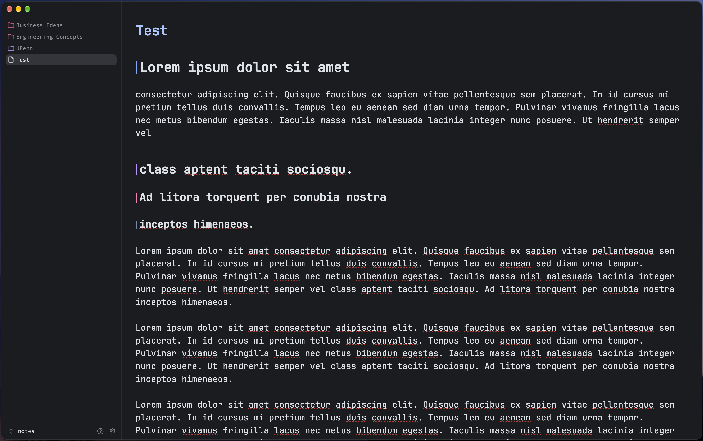

# Oxocarbon Grey for Obsidian

A dark Obsidian theme that uses the [Oxocarbon Grey](https://github.com/viraj-s15/oxocarbon-grey) palette, the same one as the VS Code, Zed, Neovim and Ghostty ports. Its layout follows the parts of the [Border](https://github.com/Akifyss/obsidian-border) theme that keep the workspace quiet, with faster motion.



## What it changes

- The tab bar, the note title bar, the sidebar buttons, the status bar and the ribbon hide until the pointer reaches them. A bar appears within 100 ms and hides 200 ms after the pointer leaves, whereas Border waits 75 ms to show a bar and 600 ms to hide one.
- The animations change only height, margin and opacity, and the theme never uses `:has()`, which Obsidian's own style guide warns is slow to re-evaluate.
- Every background is the same flat graphene grey, `#1b1c1f`.
- Folder names are bold, and each folder gets a Lucide folder icon in one of eight Oxocarbon accents. Files get icons by type, with separate ones for PDFs, canvases and images.
- Headings have white text and a coloured bar before them, which moves from blue for h1 through purple for h2 to rose for h3, while h4 to h6 use a muted steel. The note title is light blue.
- Bold text is rose and italic text is purple.
- The theme turns its animations off when the system asks for reduced motion.

## Install

1. Open Settings, then Appearance, and click Manage next to Themes.
2. Search for Oxocarbon Grey, then install and use it.
3. Reset the accent colour in Appearance, because a custom accent replaces the theme's blue.

The theme is dark only. Install the [Style Settings](https://github.com/mgmeyers/obsidian-style-settings) plugin to keep any bar visible or to turn off the icons, the folder colours, the bold folder names, the heading bars or the line under the note title.

## Develop

The palette comes from the `oxocarbon-grey` repository as a dev dependency, so `theme.css` is generated and should not be edited by hand.

1. Run `npm install`.
2. Edit the partials in `src/css/` or the colour mapping in `src/variables.mjs`. Partials are joined in file-name order, so a new feature is one new numbered file.
3. Run `npm run build` to write `theme.css`.
4. Run `npm run check` to confirm that `theme.css` is up to date, run the tests and lint the CSS with Obsidian's stylelint config.

To try the theme in a vault, link the two theme files into a folder in the vault's themes folder and pick Oxocarbon Grey in Appearance. Obsidian does not list a theme whose folder is itself a link, so link the files and not the folder:

```sh
mkdir "<vault>/.obsidian/themes/Oxocarbon Grey"
ln -s "$PWD/manifest.json" "$PWD/theme.css" "<vault>/.obsidian/themes/Oxocarbon Grey/"
```

## Release

1. Bump `version` in `manifest.json`.
2. Create a GitHub release whose tag equals that version, and attach `manifest.json` and `theme.css`.

The first release also needs a submission at [community.obsidian.md](https://community.obsidian.md), and later releases reach users without one.

## Licence

MIT. The notices for the oxocarbon.nvim palette (MIT), Border (MIT) and the Lucide icons (ISC) are in `NOTICE`.
